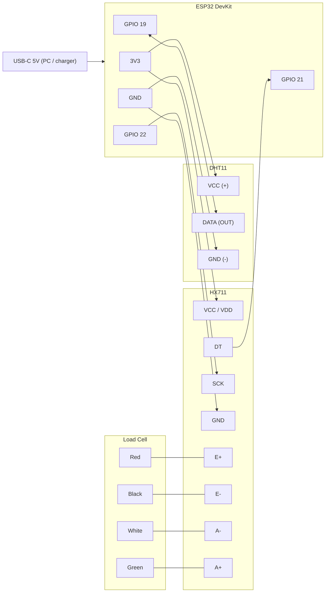

# SipSense Hardware: Pin Diagram & Flashing Guide

**Phase 1:** ESP32 + DHT11 + HX711 + load cell, powered only by **USB-C**. No battery yet.

| Sketch | Folder | Purpose |
|---|---|---|
| **A** | [`SipSense_DHT11_BLE`](SipSense_DHT11_BLE/SipSense_DHT11_BLE.ino) | Reads temperature/humidity and sends them to the SipSense app over BLE |
| **B** | [`SipSense_HX711_Calibration`](SipSense_HX711_Calibration/SipSense_HX711_Calibration.ino) | Interactive load-cell calibration over the Serial Monitor; saves the result to flash |

> **Wire everything once.** Both sketches use the same pins, so you can flash either one without rewiring.
> The pins also match the existing [`SipSense_BLE_Simulator`](SipSense_BLE_Simulator/SipSense_BLE_Simulator.ino).

---

## 1. Bill of Materials

| Qty | Part | Notes |
|---|---|---|
| 1 | ESP32 DevKit (ESP32-WROOM-32, USB-C) | Board type in Arduino IDE: **ESP32 Dev Module** |
| 1 | DHT11 temperature & humidity sensor | 3-pin module (pull-up resistor already on the board) or bare 4-pin sensor |
| 1 | HX711 24-bit load-cell amplifier board | Usually green or purple |
| 1 | Load cell (4-wire strain-gauge bar) | Red / Black / White / Green wires |
| 1 | USB-C **data** cable | Some cables only carry power. Those cannot upload sketches. |
| ~10 | Jumper wires (F-F or M-F) | |
| 0-1 | 10 kΩ resistor | **Only** needed for a bare 4-pin DHT11 |

---

## 2. Power (USB-C only)

```
 PC / 5V USB charger ──USB-C──► ESP32 on-board regulator ──► 3V3 pin ──┬──► DHT11  VCC
                                                                       └──► HX711  VCC
                                 GND pin ──────────────────────────────┬──► DHT11  GND
                                                                       └──► HX711  GND
```

| Device | Supply | Typical current |
|---|---|---|
| ESP32 (BLE active) | 5 V USB → 3.3 V | ~100–130 mA |
| DHT11 | 3V3 | ~1–2.5 mA |
| HX711 + load cell | 3V3 | ~5 mA |
| **Total** | | **≈ 140 mA**, well within what USB supplies |

> [!IMPORTANT]
> **Power both sensors from 3V3, not VIN/5V.** The ESP32's GPIOs are **3.3 V only**.
> An HX711 or DHT11 powered from 5 V drives its data line at 5 V, which can damage the ESP32 over time.
> Both modules work fine at 3.3 V.

> [!NOTE]
> Some HX711 boards (e.g. SparkFun) have **two** supply pins, `VCC` (analog) and `VDD` (logic).
> Connect **both** to 3V3.

---

## 3. Master Pin Map

| ESP32 pin | GPIO | Connects to | Direction | Notes |
|---|---|---|---|---|
| **3V3** | — | DHT11 VCC, HX711 VCC (and VDD) | Power out | Shared 3.3 V rail |
| **GND** | — | DHT11 GND, HX711 GND | Ground | Shared ground |
| **D19** | GPIO 19 | DHT11 **DATA** | Bidirectional | Single-wire protocol |
| **D21** | GPIO 21 | HX711 **DT** (DOUT) | Input to ESP32 | Serial data from the HX711 |
| **D22** | GPIO 22 | HX711 **SCK** (PD_SCK) | Output from ESP32 | Clock |
| D34 | GPIO 34 | *(reserved: battery voltage divider)* | Input only | Leave unconnected for now |

**HX711 ↔ Load cell**

| Load cell wire | HX711 pin | Meaning |
|---|---|---|
| 🔴 Red | **E+** | Excitation + |
| ⚫ Black | **E−** | Excitation − |
| ⚪ White | **A−** | Signal − |
| 🟢 Green | **A+** | Signal + |

> If readings go **down** when you add weight, swap White and Green. The calibration sketch also handles this
> on its own by using a negative factor, so swapping is optional.

---

## 4. Pin Diagram

The layout below is the common **30-pin ESP32 DevKit V1**, viewed from the top with the antenna up and USB-C at the bottom.
Every connection is on the **right-hand header**, which makes wiring easy.

```
                         ┌───────────────────────────┐
                         │   ┌───────────────────┐   │
                         │   │  ESP32-WROOM-32   │   │
                         │   │    (antenna)      │   │
                         │   └───────────────────┘   │
                  EN  ○──┤                           ├──○  D23
              VP/36   ○──┤                           ├──○  D22  ─────────────► HX711  SCK
              VN/39   ○──┤                           ├──○  TX0
                D34   ○──┤ (reserved: battery ADC)   ├──○  RX0
                D35   ○──┤                           ├──○  D21  ◄───────────── HX711  DT
                D32   ○──┤                           ├──○  D19  ◄────────────► DHT11  DATA
                D33   ○──┤                           ├──○  D18
                D25   ○──┤                           ├──○  D5
                D26   ○──┤                           ├──○  TX2
                D27   ○──┤                           ├──○  RX2
                D14   ○──┤                           ├──○  D4
                D12   ○──┤                           ├──○  D2
                D13   ○──┤                           ├──○  D15
                GND   ○──┤                           ├──○  GND  ──────┬──────► DHT11  GND
                VIN   ○──┤                           ├──○  3V3  ───┬──┼──────► DHT11  VCC
                         │        [ USB-C ]          │             │  │
                         └───────────────────────────┘             │  └──────► HX711  GND
                                    ▲                              └─────────► HX711  VCC (+VDD)
                                    │
                             5 V from PC / charger


   ┌──────────────┐        ┌────────────────────┐          ┌─────────────────────────┐
   │    DHT11     │        │       HX711        │          │   LOAD CELL (4-wire)    │
   │  (3-pin mod) │        │                    │          │                         │
   │  +   OUT  -  │        │ E+  E-  A-  A+     │◄─────────┤ Red Black White Green   │
   └──┬────┬───┬──┘        │ B-  B+             │          └─────────────────────────┘
      │    │   │           │ GND DT  SCK VCC    │
     3V3  D19 GND          └──┬───┬───┬───┬─────┘
                             GND D21 D22 3V3
```

> [!NOTE]
> **38-pin boards** order their pins differently. Ignore the physical position and match by the **GPIO number**
> printed on the silkscreen. It may read `D19`, `G19`, `IO19`, or just `19`.

### Wiring diagram (logical)



---

## 5. Module Details

### 5.1 DHT11

| Variant | Pins (left → right, grille facing you) | Wiring |
|---|---|---|
| **3-pin module** (on a small PCB) | `+` / `OUT` / `−` (order varies, so read the labels) | `+`→3V3, `OUT`→GPIO 19, `−`→GND |
| **Bare 4-pin sensor** | 1 VCC, 2 DATA, 3 NC, 4 GND | VCC→3V3, DATA→GPIO 19, GND→GND, **plus a 10 kΩ resistor between DATA and 3V3** |

- Range is 0–50 °C (±2 °C) and 20–90 % RH (±5 %). Read it no faster than once per second; the sketch uses 2 s.
- Keep the sensor **away from the ESP32 chip and its regulator**. Both get warm and will push the reading up by 1–3 °C.

### 5.2 HX711 + Load Cell

- Use channel **A** (`A+`/`A−`). The sketch runs at gain 128. Leave `B+`/`B−` unconnected.
- Most boards come with the `RATE` pin set to **10 samples/s**, which is what the sketch expects.
- **Mounting matters more than wiring.** The bar has to bend to measure anything:

```
          force (weight) ↓
   ┌───────────────[ platform ]──────────┐
   │ spacer ▓                            │
   ╞═════▓═════════[ LOAD CELL BAR ]═════▓═════╡   ← arrow on the bar points DOWN
                                         ▓ spacer
   └──────────────[ base / table ]───────┘
```

  - Bolt one end to the base and the other end to the platform, with a **spacer under each end** so the middle can flex.
  - The arrow printed on the bar shows the force direction. It should point **down**.
  - Nothing except the load cell should touch the platform. Cables resting on it will throw off the reading.

### 5.3 Pins to avoid / reserved

| Pins | Reason |
|---|---|
| GPIO 6–11 | Wired to the on-board flash chip. **Never use.** |
| GPIO 0, 2, 5, 12, 15 | Strapping (boot-mode) pins. Wiring sensors here can stop the board from booting or flashing. |
| GPIO 1, 3 | USB serial (TX0/RX0), used for uploading and the Serial Monitor |
| GPIO 34 | Reserved for the battery voltage divider in phase 2 |

---

## 6. Arduino IDE Setup (one-time)

1. **Install the ESP32 core:** **File → Preferences → Additional Boards Manager URLs** → add
   `https://espressif.github.io/arduino-esp32/package_esp32_index.json`
   Then **Tools → Board → Boards Manager** → search **esp32** → install **esp32 by Espressif Systems**.
2. **Install libraries** (**Sketch → Include Library → Manage Libraries…**):

   | Library | Author | Used by |
   |---|---|---|
   | DHT sensor library | Adafruit | Sketch A |
   | Adafruit Unified Sensor | Adafruit | Sketch A (dependency; accept the "install all" prompt) |
   | HX711 Arduino Library | Bogdan Necula (bogde) | Sketch B |

   BLE and Preferences come with the ESP32 core. Nothing extra to install.
3. **Board settings** (**Tools** menu):
   - Board: **ESP32 Dev Module**
   - Port: the COM port that shows up when you plug in the board
   - Upload Speed: 921600 (drop to 115200 if uploads fail)
   - Partition Scheme: **Default**. If Sketch A reports *"Sketch too big"*, choose **Huge APP (3MB No OTA/1MB SPIFFS)**.
4. **USB driver:** if no COM port appears, install the driver for your board's USB chip. **CH340/CH9102** is the
   most common on USB-C boards; **CP210x** is the other one. The chip name is printed near the USB connector.

---

## 7. Sketch A: DHT11 → SipSense App (BLE)

**File:** [`SipSense_DHT11_BLE.ino`](SipSense_DHT11_BLE/SipSense_DHT11_BLE.ino)

### How it reaches the app

The ESP32 acts as the **"SipSense-Bottle"** BLE peripheral. It uses the same service and characteristic UUIDs as
[`BleConstants.kt`](../app/src/main/java/com/sipsense/app/data/BleConstants.kt), so the app treats it as the real bottle.

| Item | Value |
|---|---|
| Device name | `SipSense-Bottle` |
| Service UUID | `4fafc201-1fb5-459e-8fcc-c5c9c331914b` |
| Characteristic UUID | `beb5483e-36e1-4688-b7f5-ea07361b26a8` (Read + Notify) |
| Notify interval | every 5 s (sensor sampled every 2 s) |

### Telemetry Contracts

- **Normal Reading Payload:**
  ```json
  {"status":"OK","ambientTemperature":25,"temperature":25,"humidity":61,"temperatureC":25.4,"sensor":"DHT11","uptimeMs":123456}
  ```
- **Sensor Read Failed Payload:**
  ```json
  {"status":"Read Failed","error":"Read Failed","readFailed":true,"sensor":"DHT11","failCount":1,"uptimeMs":123456}
  ```

### App Ambient Temperature Behavior
- **No Default Value:** Before any reading is received, the app displays `--` with status `Awaiting Sensor` and 0 progress (the initial 24°C default is removed).
- **On "Read Failed" Signal:** The thermometer icon switches dynamically to a red alert/error icon (`ic_error`), text displays `ERR`, and the status updates to `Read Failed` in red.
- **Terminal Display:**
  - **ESP32 Serial Monitor / Terminal (115200 baud):** Prints live formatted readings:
    `[DHT11] 🌡️ Temperature: 25.4 °C (77.7 °F) | 💧 Humidity: 61 %`
    and transmission notifications. If read fails, it alerts `[DHT11] ⚠️ Read failed!`.
  - **SipSense App Signals Terminal (Developer Mode):** Logs real-time color-coded events:
    `[RX ◀] [TEMP] 🌡️ Temperature Reading: 25.4°C | Humidity: 61%`
    or `[ERR!] [DHT11] ❌ [SENSOR ERROR] DHT11 Read Failed signal received from ESP32`.

### Flash & test

1. Wire the DHT11 (section 5.1) and plug in USB-C.
2. Open `SipSense_DHT11_BLE.ino` → **Upload**.
   *If you see `Failed to connect… Wrong boot mode`, hold the **BOOT** button until `Connecting…` finishes.*
3. Open **Serial Monitor @ 115200**. You should see live readings:
   ```
   [DHT11] Initialized on GPIO 19
   [BLE] Advertising as 'SipSense-Bottle'. Open the SipSense app to connect.
   [DHT11] 🌡️ Temperature: 25.4 °C (77.7 °F) | 💧 Humidity: 61 %
   [BLE] 📤 Transmitted Temperature Reading -> {"status":"OK","ambientTemperature":25,...}
   ```
4. On your phone, turn on Bluetooth (and Location on Android 11 and below), open **SipSense**, and log in.
   - The Dashboard connects automatically. You can also go to **Developer Mode → Scan** to connect manually.
   - When connected, the Dashboard **Ambient Temp** card displays the live temperature (e.g. `25°C`) and replaces `--`.
   - Open **Developer Mode → Signals Terminal** to watch the live `[TEMP]` readings stream into the terminal in real time.
   - If you unplug or disconnect the DHT11 data pin, the ESP32 transmits the `Read Failed` signal, the Dashboard icon switches to the error indicator with `ERR`, and the terminal logs `[ERR!] [DHT11] Read Failed`.
5. Optional check without the app: connect with **nRF Connect** (Android/iOS), open the service above, and
   enable notifications on the characteristic to see the JSON.

---

## 8. Sketch B: HX711 Weight Calibration

**File:** [`SipSense_HX711_Calibration.ino`](SipSense_HX711_Calibration/SipSense_HX711_Calibration.ino)

### What you need

- A **known reference weight**, ideally close to what you will actually measure. For a bottle, **500–1000 g** is good.
  Weigh any object (for example a sealed water bottle) on a kitchen scale and use that number.

### Flash & calibrate

1. Wire the HX711 and load cell (section 5.2). Make sure the cell is mounted and the platform is **empty**.
2. Open `SipSense_HX711_Calibration.ino` → **Upload**.
3. Open **Serial Monitor @ 115200** and set line ending to **Newline**.
4. On first boot the sketch tares (zeroes) itself and starts printing raw values.
5. Type **`c`** and press Enter, then follow the prompts:

   ```
   STEP 1/3: Remove EVERYTHING from the load cell platform.   → type y
   [TARE] Done. Zero offset = 84213
   STEP 2/3: Place your KNOWN reference weight...             → type 500
   STEP 3/3: Verifying...
             Reference: 500.0 g | Measured: 499.6 g | Error: -0.08 %
   >>> CALIBRATION FACTOR = 421.3517  (raw counts per gram)
   >>> ZERO OFFSET        = 84213
   Save to flash? Type y to save or n to skip.                → type y
   ```

6. Live readings now show grams (and the matching mL of water):
   ```
   Weight:    499.8 g  (~  500 mL water) | raw: 294890
   ```
7. **Write down the calibration factor.** It is also stored in the ESP32's flash, in the NVS namespace `sipsense`
   (keys `hx_factor`, `hx_offset`, `hx_calib`). Flashing a different sketch later does **not** erase it, unless you
   turn on *Tools → Erase All Flash Before Sketch Upload*.

### Command reference

| Command | Action |
|---|---|
| `c` | Guided calibration with a known weight |
| `t` | Tare / zero (platform must be empty) |
| `f 421.35` | Set the factor by hand (for fine-tuning) |
| `s` / `l` / `x` | Save / load / erase calibration in flash |
| `r` | One averaged raw reading |
| `p` | Pause / resume live readings |
| `i` | Show the current factor and offset |
| `h` | Help |

### Fine-tuning tip

If the scale reads a little **high**, make the factor slightly **larger**. If it reads **low**, make it **smaller**.
For example, if it shows 505 g for a 500 g weight: `new factor = old × 505 / 500`. Enter it with `f <value>` and save with `s`.

---

## 9. Troubleshooting

| Symptom | Likely cause / fix |
|---|---|
| No COM port in Arduino IDE | Charge-only USB-C cable, or the CH340/CP210x driver is missing |
| `Failed to connect to ESP32: Wrong boot mode` | Hold **BOOT** during `Connecting…`. Check that nothing is wired to GPIO 0/2/12/15 |
| `Sketch too big` (Sketch A) | Tools → Partition Scheme → **Huge APP** |
| `[DHT11] Read failed` every time | DATA isn't on GPIO 19, a bare sensor is missing its 10 kΩ pull-up, or VCC/GND are swapped |
| Temperature reads 2–3 °C high | Sensor is too close to the ESP32 or regulator. Move it away on longer wires |
| App can't find `SipSense-Bottle` | Bluetooth/Location permissions are off, or another phone or nRF Connect is already connected (only one connection at a time) |
| App connects but temperature doesn't change | Check the Serial Monitor for `Sent ->`. Open the Dashboard tab, which is where telemetry is processed |
| Temperature displays `--` | Expected behavior when ESP32 is turned off / disconnected (shows `Awaiting Sensor`), or if DHT11 sensor read failed (shows warning error icon + `Read Failed`) |
| `[HX711] Not responding!` | DT/SCK swapped or loose, or the HX711 has no 3V3/GND |
| Weight jumps around / drifts | Load cell not mounted rigidly, cables touching the platform, or wires too long. Twist the four load-cell wires together and re-tare |
| Reading goes negative when weight is added | A+/A− swapped. Either swap White/Green, or keep the negative factor (it still works) |
| Calibration says *"Raw change too small"* | Load cell can't flex (missing spacers), the weight is too light, or E+/E−/A+/A− are wired wrong |

---

## 10. Next Steps (Phase 2: battery)

- Add the LiPo + charger/boost module and a **voltage divider into GPIO 34** (already reserved).
- Merge both sketches into one SipSense firmware. It will read `hx_factor`/`hx_offset` from NVS, convert grams to
  `waterLevel` (mL), detect sips, and send the full JSON payload the app already supports.
